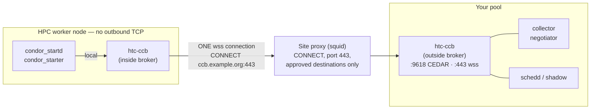
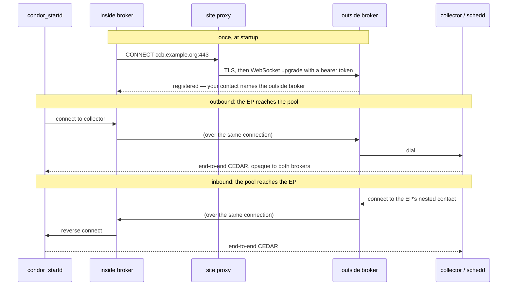
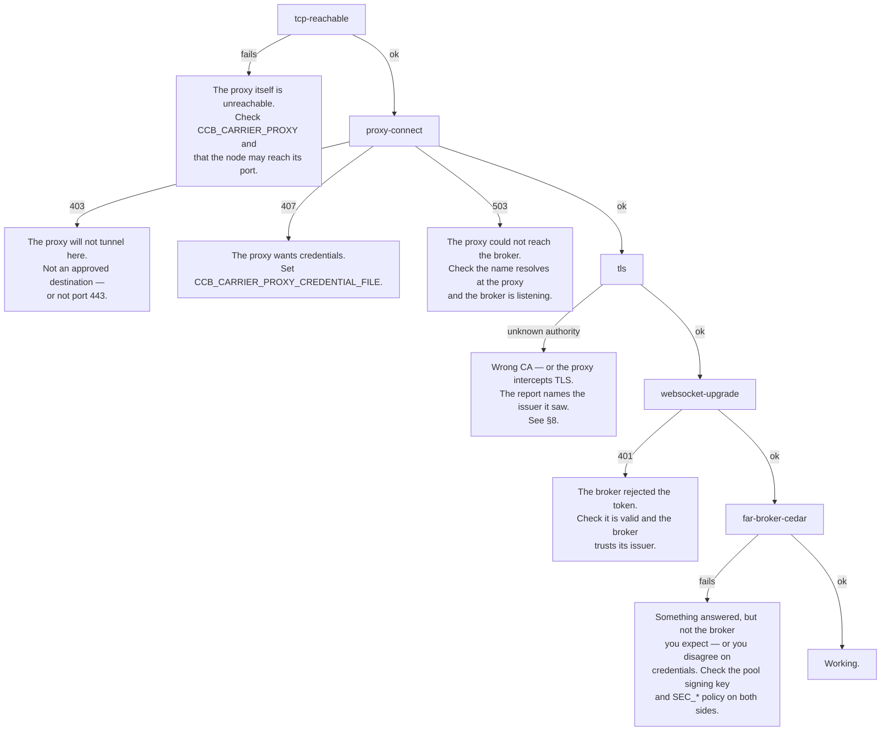

# Running an execution point behind a site HTTP proxy

A guide for site and pool administrators.

Some HPC worker nodes cannot open outbound TCP connections. Many of those sites
do run an HTTP proxy — usually squid — and permit outbound traffic through it to
an approved list of destinations. This guide shows how to put an HTCondor
execution point on such a node: it reaches your pool through **one** proxied TLS
connection, and the pool reaches it back down the same connection.

Nothing in your central manager, schedd or submit hosts changes. The only new
component is a second `htc-ccb`, one on each side.

---

## 1. Do you need this?

| Your worker nodes can… | Use |
|---|---|
| open outbound TCP to your CCB's port | ordinary CCB — `CCB_ADDRESS`, nothing here applies |
| open outbound TCP, but too few sockets | this guide; the whole node collapses to one connection |
| reach only an HTTP proxy, to approved destinations | this guide |
| reach nothing at all, but share a filesystem with the pool | the filesystem carrier in [TRANSPORTS.md](TRANSPORTS.md) §4 |

If an ordinary CCB works at your site, use it. What follows costs you a public
TLS endpoint and a conversation with whoever runs the proxy.

---

## 2. How it works

Two brokers. One sits on the worker node, inside the restricted network; one
sits with your pool, in the open. The inside broker opens a single WebSocket to
the outside broker, through the site proxy, and every connection the execution
point makes or receives is multiplexed over it.



The single connection carries both directions:

- **Outbound** — the startd advertising itself, the starter talking to a shadow.
  The inside broker forwards each one to the outside broker, which dials the
  real destination.
- **Inbound** — the schedd claiming the startd, a shadow reaching a starter. The
  execution point's advertised address is a *nested* contact naming the outside
  broker, so a connection arrives there and is relayed down the tunnel.



**The brokers never hold your keys.** They relay opaque bytes; the execution
point and its peer run a full CEDAR handshake — authentication, integrity,
encryption — straight through. Turning on `SEC_DEFAULT_ENCRYPTION = REQUIRED`
pool-wide works unchanged.

---

## 3. What to ask the site for

Settle these before configuring anything; each one is a hard blocker and each
shows up as a different failure.

1. **A destination approved for `CONNECT`.** The hostname of your outside
   broker, for example `ccb.example.org`. Proxies deny by default.
2. **Port 443.** A stock `squid.conf` carries
   `http_access deny CONNECT !SSL_ports` with `acl SSL_ports port 443`, so a
   broker listening anywhere else is refused no matter what else is approved.
   Your broker still serves ordinary CEDAR to the pool on 9618 — that port never
   goes near the proxy.
3. **Whether the proxy requires authentication.** If so, you need a
   username and password (§5).
4. **Whether the proxy intercepts TLS** (`ssl_bump`). If it does, you need the
   site's CA certificate, and you should read §8 before going further.

You also need, on your side, a TLS certificate for the broker's hostname that
the worker nodes will trust.

---

## 4. Configuration

### 4.1 The outside broker

Runs with your pool, on a host the proxy may reach. Give it a normal HTCondor
configuration plus:

```condor
# Serve CCB to the pool as usual.
DAEMON_LIST = $(DAEMON_LIST), CCB
CCB = /usr/sbin/htc-ccb
CCB_ARGS = -listen 0.0.0.0:9618 -public ccb.example.org:9618
CCB_LOG = $(LOG)/CcbLog

# Accept tunnels from worker nodes. Port 443 is not optional (§3.2).
CCB_CARRIER_LISTEN = wss://0.0.0.0:443/ccb/tunnel
CCB_CARRIER_TLS_CERT = /etc/condor/certs/ccb.example.org.crt
CCB_CARRIER_TLS_KEY  = /etc/condor/certs/ccb.example.org.key

# Act as the exit for tunneled nodes' outbound connections, bounded to the pool.
CCB_OUTBOUND_PROXY = TRUE
CCB_OUTBOUND_TARGET_ALLOWLIST = 192.0.2.0/24
```

`CCB_OUTBOUND_TARGET_ALLOWLIST` is deny-by-default and should name only your
pool. Without it the tunnel would be an open proxy into your network.

It matches the target **as the daemon wrote it**, and does not resolve names: a
CIDR entry covers targets named by IP, and a target named by hostname needs a
hostname entry (an exact name or a glob such as `*.example.org`). If your
daemons advertise themselves by name, list both forms — a CIDR-only allow-list
will refuse them, with `target host "…" not permitted` in `CcbLog`.

Arriving tunnels are authenticated by bearer token: an HTCondor IDTOKEN verified
against your pool signing key, or a SciToken verified against its issuer. No
configuration is needed to enable this — it follows the pool's existing
credentials.

### 4.2 The inside broker, on the worker node

This is the configuration a glidein gives its broker:

```condor
CCB_OUTBOUND_PROXY = TRUE
CCB_OUTBOUND_NEXT_HOP = wss://ccb.example.org/ccb/tunnel
CCB_CARRIER_PROXY = http://squid.site.example:3128
CCB_CARRIER_CA_FILE = $(LOCAL_DIR)/ca.pem
CCB_TUNNEL_READY_FILE = $(LOCAL_DIR)/ccb_tunnel_ready

# Reach the pool through the tunnel, not directly.
CCB_OUTBOUND_TARGET_ALLOWLIST = 192.0.2.0/24
```

The credential is found the way a glidein already carries one: `BEARER_TOKEN`,
`BEARER_TOKEN_FILE`, `$XDG_RUNTIME_DIR/bt_u<uid>`, `/tmp/bt_u<uid>`, then an
HTCondor IDTOKEN from the token directory. Set `CCB_CARRIER_TOKEN` only to
override that.

### 4.3 The execution point's daemons

Point them at the local broker, for both directions:

```condor
DAEMON_LIST = MASTER, STARTD
USE_SHARED_PORT = FALSE
CCB_ADDRESS = <inside broker host:port>
OUTBOUND_CCB_ADDRESS = <inside broker host:port>
```

`CCB_ADDRESS` makes the startd reachable; `OUTBOUND_CCB_ADDRESS` routes what it
dials. The inside broker stamps the nesting into the contacts it hands out, so
the startd advertises an address the pool can reach without knowing anything
about the tunnel.

### 4.4 Startup order

There is nothing to sequence by hand. The glidein runs `condor_master`, and the
broker is one of its daemons — list it first so the master starts it first:

```condor
DAEMON_LIST = MASTER, CCB, STARTD
CCB = /usr/sbin/htc-ccb
CCB_ARGS = -listen 127.0.0.1:9700 -public 127.0.0.1:9700
CCB_LOG = $(LOG)/CcbLog
```

The broker verifies its carrier and waits for upstream registration **before**
it reports itself ready, so it is not ready until it can do its job.
`CCB_CARRIER_READY_TIMEOUT` (seconds, default 120) bounds that wait. If it
expires the broker starts anyway and logs the staged report loudly — a broker
that refused to start would be restarted in a loop and you would lose the
diagnosis that report just produced.

A startd that starts before the tunnel is up is not a problem either: the broker
refuses to register it rather than hand it an address the pool cannot reach, and
its `CCBListener` retries until the tunnel is ready. That refusal is the thing
protecting you, not the ordering.

`CCB_TUNNEL_READY_FILE` remains useful for anything outside the master's control
that needs to wait for a working tunnel — a wrapper that reports the glidein's
state back to a factory, say.

---

## 5. A proxy that requires authentication

Put the credential in a file rather than the configuration, which is
world-readable:

```condor
CCB_CARRIER_PROXY = http://squid.site.example:3128
CCB_CARRIER_PROXY_CREDENTIAL_FILE = /etc/condor/proxy.cred
```

```sh
install -m 600 /dev/null /etc/condor/proxy.cred
printf 'username:password\n' > /etc/condor/proxy.cred
```

The file is re-read on every connection attempt, so rotating it needs no
restart. A world-readable file is refused at startup.

### Configuration versus the environment

If `CCB_CARRIER_PROXY` is unset, the site's `https_proxy` / `no_proxy`
environment is used. If it is set, it **wins** — including
`CCB_CARRIER_PROXY = none`, which forces a direct connection even where the
environment exports a proxy. This matters because a daemon started by
`condor_master` need not inherit the site's environment at all, so the
configuration file is the only reliable place to say what you mean.

The log records which of the two was used:

```
CCB carrier proxy configuration source="CCB_CARRIER_PROXY (overriding any environment proxy)"
```

---

## 6. Checking that it works

```sh
htc-ccb -listen 127.0.0.1:0 -carrier-check
```

It walks the path one layer at a time and exits non-zero on the first failure:

```
carrier wss://ccb.example.org/ccb/tunnel (via http://squid.site.example:3128)
  ok   tcp-reachable      connected to squid.site.example:3128 (4ms)
  ok   proxy-connect      proxy tunneled to ccb.example.org:443 (31ms)
  ok   tls                TLS 1.3, subject "ccb.example.org", issuer "Example CA", expires 2027-01-04T00:00:00Z
  ok   websocket-upgrade  upgrade accepted and authenticated (44ms)
  ok   far-broker-cedar   handshake completed with ep@example.org (auth TOKEN)
```

Each stage answers a different question, which is the point — a single "could
not connect" tells you nothing about which of five things is wrong.



The same report is written to `CcbLog` at startup, so you can read it after the
fact without re-running anything.

---

## 7. Everyday operation

**One connection per node.** While jobs run, a worker node holds exactly one
TCP connection, to the proxy. You can confirm it:

```sh
ss -tnp state established '( dport = :3128 )'
```

If you see more than one per inside broker, something is bypassing the tunnel.

**Idle periods, and the one knob to get right.** A glidein can sit idle for
hours, and a quiet carrier sends nothing of its own except a keepalive. That
keepalive is therefore the only thing stopping the site proxy from reclaiming
the tunnel as idle, so it has to be shorter than the shortest idle timeout on
the path — squid's `read_timeout`, plus any load balancer in front of the
broker. Ask the site for both numbers.

```condor
CCB_CARRIER_KEEPALIVE = 30
```

Seconds; 30 is the default. Lower it if the site's timeout is shorter.

**Set it too slow and nothing appears to break.** The proxy drops the tunnel,
the broker rebuilds it on next use, and every connection still succeeds — so a
misconfigured keepalive does not show up as an error. What it costs is a new
connection through the proxy each time the node goes quiet, which is exactly the
socket budget the tunnel exists to conserve, and any connection in flight at the
moment of the drop. Check for it by counting tunnels rather than by looking for
failures:

```sh
grep -c 'CONNECT .* TCP_TUNNEL' /var/log/squid/access.log
```

One per glidein broker over its whole lifetime is right. Many per node means the
keepalive is losing the race with the proxy.

**Restarts.** The inside broker reconnects on its own. An execution point whose
broker is briefly away keeps its address — contacts survive a broker restart.

**Logs worth watching** in `CcbLog`:

| Line | Meaning |
|---|---|
| `carrier session established ... route="via …"` | the tunnel came up, and through what |
| `carrier health check passed` | all five stages green at startup |
| `carrier ready tunnel_contact=…` | registered upstream; contacts will nest |
| `register refused: … not tunnel-ready` | an EP started before the tunnel; it will retry |
| `proxy-connect splice established` | one relayed outbound connection |

---

## 8. Security

**What the brokers see.** Opaque bytes. Both ends run their own CEDAR
handshake through the relay, so authentication, integrity and encryption are
end-to-end. A compromised broker can disrupt traffic; it cannot read or forge
it.

**What the proxy sees.** With an ordinary proxy: a `CONNECT` to your broker's
hostname and an encrypted stream. Nothing else.

**If the proxy intercepts TLS.** The connection terminates at the proxy and is
re-encrypted, so the proxy sees the WebSocket handshake. If that handshake
carries a bearer token, the proxy now holds a reusable pool credential. Where a
site bumps TLS:

- add the site CA to `CCB_CARRIER_CA_FILE`, or the broker will correctly refuse
  to connect, and
- set `CCB_CARRIER_AUTH = none` on the outside broker and on every inside
  broker, so the upgrade carries no credential at all.

With `CCB_CARRIER_AUTH = none` the glidein's broker is still authenticated —
just later, and without exposing anything. CEDAR authenticates it on its first
command (`CCB_REGISTER`, at `DAEMON`) by proof of possession: the handshake puts
only the token's header and payload on the wire and keeps its signature as a
shared secret, so a proxy that reads the whole exchange cannot replay it. That
was always the identity your `ALLOW_DAEMON` policy acted on; the token on the
upgrade was never consulted for authorization.

Two things to check when you turn it on:

- **`ALLOW_DAEMON` must admit the glidein by identity.** A carrier peer has no
  network address, so host and netblock entries never match it — if your policy
  is purely host-based, carrier registrations were already failing. Add the pool
  identity, e.g. `ALLOW_DAEMON = $(ALLOW_DAEMON), condor_pool@$(UID_DOMAIN)`.
- **`CCB_OUTBOUND_TARGET_ALLOWLIST` is now the only gate on where a tunnel can
  reach.** It always was the one that mattered. Set it to your pool and nothing
  more.

The upgrade endpoint is open in this mode, so it carries its own limits:
`CCB_CARRIER_MAX_SESSIONS` (default 1024 — one per glidein broker, so raise it
if you tunnel more nodes than that through one broker),
`CCB_CARRIER_PIPE_PROBATION` (default 60s — drops a connection that never
registers; `0` disables it), and `CCB_CARRIER_MAX_PER_SOURCE` (default off:
behind an intercepting proxy every glidein arrives from the proxy's address, so
this limit would fall on the one source that must not be limited).

Expect a different symptom from a bad credential. It used to fail the dial with
`unauthorized`; now the carrier comes up and registration never completes, so
`CCB_TUNNEL_READY_FILE` never appears and the startup barrier waits out
`CCB_CARRIER_READY_TIMEOUT`. Look for the authentication or authorization
failure in the **outside** broker's log.

What this does not change is what an intercepting proxy can do *to* the
connection: it sits in the path and can slow, drop or deny the tunnel whenever
it likes. No credential arrangement prevents that — the broker's reconnect
handling is what limits the damage.

**The outbound allow-list.** `CCB_OUTBOUND_TARGET_ALLOWLIST` on the outside
broker is what stops a tunnel being a general-purpose route into your network.
Set it to your pool and nothing more.

---

## 9. Configuration reference

### Outside broker

| Knob | Meaning |
|---|---|
| `CCB_CARRIER_LISTEN` | `wss://0.0.0.0:443/ccb/tunnel` — where tunnels arrive |
| `CCB_CARRIER_TLS_CERT` / `CCB_CARRIER_TLS_KEY` | the certificate for that endpoint |
| `CCB_OUTBOUND_PROXY` | enable relaying tunneled nodes' outbound connections |
| `CCB_OUTBOUND_TARGET_ALLOWLIST` | what those connections may reach — deny by default |
| `CCB_CARRIER_AUTH` | `token` (default) or `none` — whether the upgrade carries a bearer token. Must match on both ends |
| `CCB_CARRIER_MAX_SESSIONS` | concurrent tunnels, one per glidein broker (1024) |
| `CCB_CARRIER_MAX_PER_SOURCE` | concurrent tunnels from one address (0 = off; leave off behind a proxy) |
| `CCB_CARRIER_PIPE_PROBATION` | seconds a tunnel may sit without registering (60; `0` disables) |

### Inside broker

| Knob | Meaning |
|---|---|
| `CCB_OUTBOUND_NEXT_HOP` | `wss://…` — the outside broker's carrier endpoint |
| `CCB_CARRIER_PROXY` | proxy URL, or `none` to force a direct connection. Unset uses `https_proxy` |
| `CCB_CARRIER_PROXY_CREDENTIAL_FILE` | `user:password`, mode 600 |
| `CCB_CARRIER_CA_FILE` | CA for the broker's certificate |
| `CCB_CARRIER_TOKEN` | bearer token, if not discovered automatically |
| `CCB_CARRIER_AUTH` | `token` (default) or `none` — whether the upgrade carries a bearer token. Must match on both ends |
| `CCB_CARRIER_KEEPALIVE` | seconds between keepalives on an idle carrier (30). Must be below the proxy's idle timeout |
| `CCB_CARRIER_READY_TIMEOUT` | seconds to wait for the tunnel before reporting ready (120) |
| `CCB_TUNNEL_READY_FILE` | written once registered; a barrier for wrappers outside the master |
| `CCB_OUTBOUND_PROXY` | enable relaying the local daemons' outbound connections |

### Execution point daemons

| Knob | Meaning |
|---|---|
| `CCB_ADDRESS` | the local inside broker — makes the daemon reachable |
| `OUTBOUND_CCB_ADDRESS` | the local inside broker — routes what it dials |

Every `CCB_CARRIER_*` knob takes the usual `CCB.` and `<local-name>.` prefixes.
Note that every other `*PROXY*` setting in HTCondor names an X.509 credential;
these are an HTTP forward proxy and are read by nothing else in the pool.

---

## 10. Further reading

- [TRANSPORTS.md](TRANSPORTS.md) — the carrier design, and the filesystem
  carrier for sites with no network path at all.
- [E2E_SQUID_WS.md](E2E_SQUID_WS.md) — how this is tested, for developers.
