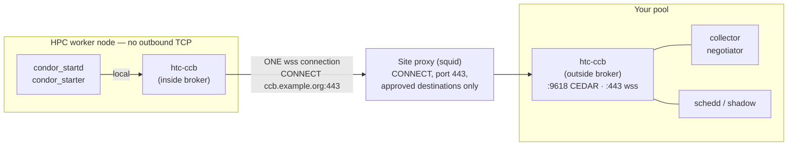
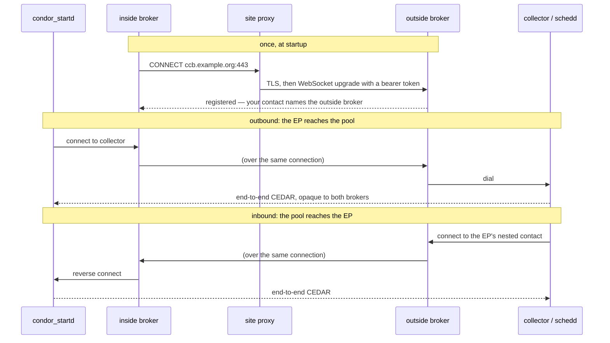
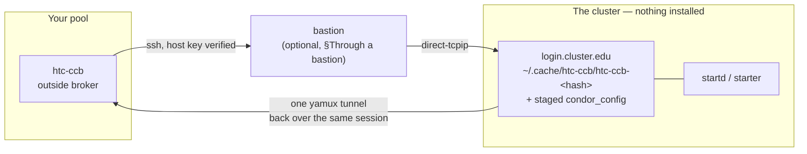
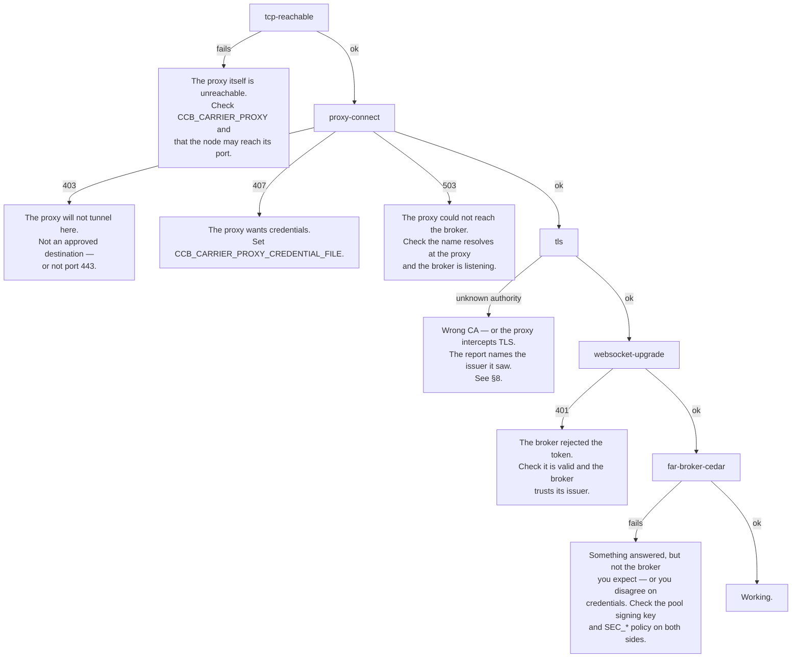

# Running an execution point behind a site HTTP proxy

A guide for site and pool administrators.

Some HPC worker nodes cannot open outbound TCP connections. Many of those sites
do run an HTTP proxy — usually squid — and permit outbound traffic through it to
an approved list of destinations. This guide shows how to put an HTCondor
execution point on such a node: it reaches your pool through **one** proxied TLS
connection, and the pool reaches it back down the same connection.

Nothing in your central manager, schedd or submit hosts changes. The only new
component is a second `htc-ccb`, one on each side.

---

## 1. Do you need this?

| Your worker nodes can… | Use |
|---|---|
| open outbound TCP to your CCB's port | ordinary CCB — `CCB_ADDRESS`, nothing here applies |
| open outbound TCP, but too few sockets | this guide; the whole node collapses to one connection |
| reach only an HTTP proxy, to approved destinations | this guide |
| reach nothing, but you can `ssh` **in** to the cluster's login host | this guide — §4.5 shape A, the usual cluster |
| the same, and you cannot install anything on the login host | this guide — §4.6, the broker stages itself |
| `ssh` **out** to a bastion and nothing else | this guide — §4.5 shape B |
| reach nothing at all, but share a filesystem with the pool | the filesystem carrier in [TRANSPORTS.md](TRANSPORTS.md) §4 |

If an ordinary CCB works at your site, use it. What follows costs you a public
TLS endpoint and a conversation with whoever runs the proxy.

---

## 2. How it works

Two brokers. One sits on the worker node, inside the restricted network; one
sits with your pool, in the open. The inside broker opens a single WebSocket to
the outside broker, through the site proxy, and every connection the execution
point makes or receives is multiplexed over it.



The single connection carries both directions:

- **Outbound** — the startd advertising itself, the starter talking to a shadow.
  The inside broker forwards each one to the outside broker, which dials the
  real destination.
- **Inbound** — the schedd claiming the startd, a shadow reaching a starter. The
  execution point's advertised address is a *nested* contact naming the outside
  broker, so a connection arrives there and is relayed down the tunnel.



**The brokers never hold your keys.** They relay opaque bytes; the execution
point and its peer run a full CEDAR handshake — authentication, integrity,
encryption — straight through. Turning on `SEC_DEFAULT_ENCRYPTION = REQUIRED`
pool-wide works unchanged.

---

## 3. What to ask the site for

Settle these before configuring anything; each one is a hard blocker and each
shows up as a different failure.

1. **A destination approved for `CONNECT`.** The hostname of your outside
   broker, for example `ccb.example.org`. Proxies deny by default.
2. **Port 443.** A stock `squid.conf` carries
   `http_access deny CONNECT !SSL_ports` with `acl SSL_ports port 443`, so a
   broker listening anywhere else is refused no matter what else is approved.
   Your broker still serves ordinary CEDAR to the pool on 9618 — that port never
   goes near the proxy.
3. **Whether the proxy requires authentication.** If so, you need a
   username and password (§5).
4. **Whether the proxy intercepts TLS** (`ssl_bump`). If it does, you need the
   site's CA certificate, and you should read §8 before going further.

You also need, on your side, a TLS certificate for the broker's hostname that
the worker nodes will trust.

All four are about an HTTP proxy. **If the site runs no proxy but permits SSH to
a bastion**, none of them apply and §4.5 has a different, shorter list: an
account on the bastion, and whether the bastion may reach your broker.

---

## 4. Configuration

### 4.1 The outside broker

Runs with your pool, on a host the proxy may reach. Give it a normal HTCondor
configuration plus:

```condor
# Serve CCB to the pool as usual.
DAEMON_LIST = $(DAEMON_LIST), CCB
CCB = /usr/sbin/htc-ccb
CCB_ARGS = -listen 0.0.0.0:9618 -public ccb.example.org:9618
CCB_LOG = $(LOG)/CcbLog

# Accept tunnels from worker nodes. Port 443 is not optional (§3.2).
CCB_CARRIER_LISTEN = wss://0.0.0.0:443/ccb/tunnel
CCB_CARRIER_TLS_CERT = /etc/condor/certs/ccb.example.org.crt
CCB_CARRIER_TLS_KEY  = /etc/condor/certs/ccb.example.org.key

# Act as the exit for tunneled nodes' outbound connections, bounded to the pool.
CCB_OUTBOUND_PROXY = TRUE
CCB_OUTBOUND_TARGET_ALLOWLIST = 192.0.2.0/24
```

`CCB_OUTBOUND_TARGET_ALLOWLIST` is deny-by-default and should name only your
pool. Without it the tunnel would be an open proxy into your network.

It matches the target **as the daemon wrote it**, and does not resolve names: a
CIDR entry covers targets named by IP, and a target named by hostname needs a
hostname entry (an exact name or a glob such as `*.example.org`). If your
daemons advertise themselves by name, list both forms — a CIDR-only allow-list
will refuse them, with `target host "…" not permitted` in `CcbLog`.

Arriving tunnels are authenticated by bearer token: an HTCondor IDTOKEN verified
against your pool signing key, or a SciToken verified against its issuer. No
configuration is needed to enable this — it follows the pool's existing
credentials.

### 4.2 The inside broker, on the worker node

This is the configuration a glidein gives its broker:

```condor
CCB_OUTBOUND_PROXY = TRUE
CCB_OUTBOUND_NEXT_HOP = wss://ccb.example.org/ccb/tunnel
CCB_CARRIER_PROXY = http://squid.site.example:3128
CCB_CARRIER_CA_FILE = $(LOCAL_DIR)/ca.pem
CCB_TUNNEL_READY_FILE = $(LOCAL_DIR)/ccb_tunnel_ready

# Reach the pool through the tunnel, not directly.
CCB_OUTBOUND_TARGET_ALLOWLIST = 192.0.2.0/24
```

The credential is found the way a glidein already carries one: `BEARER_TOKEN`,
`BEARER_TOKEN_FILE`, `$XDG_RUNTIME_DIR/bt_u<uid>`, `/tmp/bt_u<uid>`, then an
HTCondor IDTOKEN from the token directory. Set `CCB_CARRIER_TOKEN` only to
override that.

### 4.3 The execution point's daemons

Point them at the local broker, for both directions:

```condor
DAEMON_LIST = MASTER, STARTD
USE_SHARED_PORT = FALSE
CCB_ADDRESS = <inside broker host:port>
OUTBOUND_CCB_ADDRESS = <inside broker host:port>
```

`CCB_ADDRESS` makes the startd reachable; `OUTBOUND_CCB_ADDRESS` routes what it
dials. The inside broker stamps the nesting into the contacts it hands out, so
the startd advertises an address the pool can reach without knowing anything
about the tunnel.

### 4.4 Startup order

There is nothing to sequence by hand. The glidein runs `condor_master`, and the
broker is one of its daemons — list it first so the master starts it first:

```condor
DAEMON_LIST = MASTER, CCB, STARTD
CCB = /usr/sbin/htc-ccb
CCB_ARGS = -listen 127.0.0.1:9700 -public 127.0.0.1:9700
CCB_LOG = $(LOG)/CcbLog
```

The broker verifies its carrier and waits for upstream registration **before**
it reports itself ready, so it is not ready until it can do its job.
`CCB_CARRIER_READY_TIMEOUT` (seconds, default 120) bounds that wait. If it
expires the broker starts anyway and logs the staged report loudly — a broker
that refused to start would be restarted in a loop and you would lose the
diagnosis that report just produced.

A startd that starts before the tunnel is up is not a problem either: the broker
refuses to register it rather than hand it an address the pool cannot reach, and
its `CCBListener` retries until the tunnel is ready. That refusal is the thing
protecting you, not the ordering.

`CCB_TUNNEL_READY_FILE` remains useful for anything outside the master's control
that needs to wait for a working tunnel — a wrapper that reports the glidein's
state back to a factory, say.

---

### 4.5 Carrying the tunnel over SSH instead

Everything above assumes the carrier is a `wss://` tunnel through the site's
HTTP proxy. Where the site runs no proxy but does permit **SSH**, the carrier
can be `ssh` itself: a broker runs the command and uses its stdin and stdout as
the tunnel.

Nothing else changes. The outside broker still faces the pool over ordinary
CEDAR, the execution point's configuration (§4.3) is identical, and the startup
order (§4.4) is identical. Only the one line naming the carrier differs.

#### Which shape

The `ssh` can be run from either end. Which end depends on what the site
permits, and that is the whole choice:

```
 Shape A  the outside broker reaches IN        ← most clusters

   pool ──▶ ccb.example.org ──ssh──▶ login.cluster.edu ◀── jobs
                              opened from outside        (compute nodes)

   One inbound ssh. The broker it starts on the login host binds a port,
   and the jobs use that as an ordinary CCB. Nothing on the cluster dials
   out; nothing from the pool dials in.


 Shape B  the node reaches OUT, relayed         ← nothing installed on the bastion

   pool ──▶ ccb.example.org ◀──TCP── bastion ◀──ssh── node
            tcp://…:9700            (stock sshd)      (runs `ssh -W`)

   `ssh -W` is OpenSSH's own stdio-to-TCP relay: the node's ssh asks the
   bastion's sshd to open the connection to your broker on its behalf.
   Nothing of ours on the bastion, but it must be able to reach the broker.
```

| What the site permits | Shape |
|---|---|
| you may `ssh` **in** to a login host; nodes dial nothing | **A** |
| nodes may `ssh` **out** to a bastion, and the bastion may reach a broker | **B** |

#### What to ask the site for

A different list from §3, and usually a shorter conversation.

For **shape A**, the one most clusters need:

1. **An account on the login host** for the outside broker to `ssh` in as, and
   an `authorized_keys` entry for the key it will present.
2. **Somewhere to put `htc-ccb`** on the login host, and a port it may bind
   that the compute nodes can reach. That is the cluster's own network, so it
   is rarely a conversation at all.

For **shape B**, where the nodes reach out:

1. **An account on the bastion** for the node's broker to log in as, and an
   `authorized_keys` entry. This is the real cost of this carrier — the
   WebSocket one needs only a URL and a token the glidein already carries.
2. **Whether the bastion may reach your outside broker**, and on which port.
   If it may not, the broker the nodes relay to has to be one running on the
   bastion itself.

For all three: **nothing about TLS, and nothing about the proxy.** There is no
certificate to obtain and no `CONNECT` destination to have approved. A site
middlebox also cannot transparently interpose on SSH the way it can on TLS,
which is the one security property this carrier has that the WebSocket one does
not (see [CARRIER_AUTH.md](CARRIER_AUTH.md) §2).

#### Shape A — the outside broker reaches in (most clusters)

This is the shape that fits a cluster: one you can `ssh` into, whose compute
nodes dial nothing at all.

A well-known broker outside the cluster `ssh`es to the login host and starts a
broker there. That broker binds a port on the login host, and the jobs on the
compute nodes use it as an ordinary CCB: it is how they are reached, and how
they reach out. All of their traffic leaves through the one SSH connection the
outside broker opened.

```
    pool                     outside broker            login host        compute nodes
  ──────────                ───────────────          ──────────────     ───────────────
  condor_q  ──── CEDAR ───▶  ccb.example.org
                             │
                             │  ssh (the only connection,
                             │   opened from outside in)
                             ▼
                            login.cluster.edu:9618  ◀──── CEDAR ────  jobs
```

Nothing on the cluster dials out, and nothing from the pool dials in. The site
has to permit exactly one thing it almost certainly already permits: an inbound
`ssh` to the login host.

On the **outside** broker, which is also the exit for the cluster's traffic:

```condor
DAEMON_LIST = $(DAEMON_LIST), CCB
CCB = /usr/sbin/htc-ccb
CCB_ARGS = -listen 0.0.0.0:9618 -public ccb.example.org:9618

# Reach into the cluster and start the broker that serves it.
CCB_CARRIER_LISTEN = cmd:ssh login.cluster.edu /usr/sbin/htc-ccb -carrier-stdio -listen 0.0.0.0:9618 -public login.cluster.edu:9618

# Jobs on the cluster leave through here, and this is what they may reach.
CCB_OUTBOUND_PROXY = TRUE
CCB_OUTBOUND_TARGET_ALLOWLIST = collector.example.org, *.ap.example.org
```

The broker on the login host needs an HTCondor configuration of its own there,
with the half that makes it the cluster's way out:

```condor
# On login.cluster.edu. The carrier is the pipe it was started with;
# -carrier-stdio is sugar for CCB_OUTBOUND_NEXT_HOP = stdio:.
CCB_OUTBOUND_PROXY = TRUE
```

And the **jobs** point at it, for both directions, exactly as they would at any
other CCB:

```condor
CCB_ADDRESS          = login.cluster.edu:9618
OUTBOUND_CCB_ADDRESS = login.cluster.edu:9618
```

`CCB_ADDRESS` makes a job reachable; `OUTBOUND_CCB_ADDRESS` routes what it
dials. The login-host broker stamps the nesting into the contacts it hands out,
so a job advertises an address the pool can reach — `<ccb.example.org>#…#…` —
without the pool knowing anything about the cluster, and without the login host
being reachable from outside at all.

Two properties worth knowing:

- **The carrier is re-run when it dies.** If the SSH drops or the login host
  reboots, the outside broker reconnects on its own schedule
  (`CCB_CARRIER_RETRY_INITIAL`, `CCB_CARRIER_RETRY_MAX`). There is nothing to
  restart by hand.
- **The login-host broker exits when the pipe closes.** It has one carrier and
  cannot obtain another, so when its parent `ssh` goes away it shuts down
  rather than lingering as an unreachable process holding a port. A reconnect
  starts a fresh one.

If you would rather have no broker on the login host at all, `ssh -R` can make
`sshd` itself listen there and forward back out. That is a different mechanism —
not this carrier — and it comes with its own conditions: the login host's
`sshd_config` needs `GatewayPorts yes` before anything but the login host itself
may connect to the forwarded port, and the jobs are then speaking to your
outside broker directly rather than to a broker of their own, so they get no
local brokering and the forward carries every connection separately instead of
multiplexing them over one.

#### Shape B — the node reaches out, relayed through a bastion

The inside broker runs `ssh -W`, which is OpenSSH's own stdio-to-TCP relay, and
the outside broker accepts the resulting raw pipe.

On the **outside** broker, beside the pool:

```condor
DAEMON_LIST = $(DAEMON_LIST), CCB
CCB = /usr/sbin/htc-ccb
CCB_ARGS = -listen 0.0.0.0:9618 -public ccb.example.org:9618

# Where tunnels arrive. This is NOT the CEDAR port above: it is a raw carrier
# pipe, and the two are not interchangeable.
CCB_CARRIER_LISTEN = tcp://0.0.0.0:9700

CCB_OUTBOUND_PROXY = TRUE
CCB_OUTBOUND_TARGET_ALLOWLIST = collector.example.org, *.ap.example.org
```

On the **inside** broker, on the worker node:

```condor
CCB_OUTBOUND_PROXY = TRUE
CCB_OUTBOUND_NEXT_HOP = cmd:ssh -W ccb.example.org:9700 bastion.site.edu
CCB_TUNNEL_READY_FILE = $(LOCAL_DIR)/ccb_tunnel_ready
CCB_OUTBOUND_TARGET_ALLOWLIST = 192.0.2.0/24
```

If the bastion may not reach your broker, do not try to put `htc-ccb` on the
bastion as the far end of this pipe: `-carrier-stdio` makes a broker the
*inside* end, so pointing one inside broker at another leaves the pipe with two
clients and no server, and nothing comes up. What works in that case is an
ordinary, persistent outside broker running on the bastion itself, with the
nodes relaying to *it* — the same `ssh -W`, pointed at `localhost` from the
bastion's point of view. The broker there must still be able to reach the pool,
which is the question worth settling before any of this.

A `tcp://` endpoint carries no TLS and no transport credential. That is the same
posture as `CCB_CARRIER_AUTH = none` and rests on the same argument — the
identity behind every authorization decision comes from the CEDAR handshake on
the first command, not from the transport ([CARRIER_AUTH.md](CARRIER_AUTH.md)
§3). What it means in practice is that the port must not be reachable from
anywhere but the bastion. Bind it to an address the bastion can reach and
nothing else can, or firewall it to the bastion's address; the broker warns at
startup when it is bound beyond loopback. `CCB_CARRIER_MAX_SESSIONS` and
`CCB_CARRIER_MAX_PER_SOURCE` bound it either way, and note that every node
relaying through one bastion shares that bastion's address — so leave
`CCB_CARRIER_MAX_PER_SOURCE` off here, exactly as behind a proxy.

#### Two things that catch people

**The command is not run through a shell.** Quoting works — single quotes,
double quotes, backslashes — but pipelines, redirection and `$VARIABLES` do not,
and an unquoted `|`, `;`, `&`, `>`, `$` or backtick is *refused* at startup
rather than passed to `ssh` as a literal argument. Quote it if you mean it
literally:

```condor
CCB_OUTBOUND_NEXT_HOP = cmd:ssh -o 'ProxyJump jump.site.edu' -W ccb.example.org:9700 bastion.site.edu
```

**The broker is not you.** It runs as the `condor` user, usually from
`condor_master`, so `ssh` reads *that* account's `~/.ssh/config`,
`~/.ssh/known_hosts` and keys — not root's and not yours. The child inherits the
daemon's environment, so `SSH_AUTH_SOCK` and `KRB5CCNAME` carry through if they
are set for the daemon; point `HOME` somewhere the broker can actually read with
`CCB_CARRIER_COMMAND_ENV`:

```condor
CCB_CARRIER_COMMAND_ENV = HOME=/var/lib/condor
```

An unknown host key is the most common first failure, because a non-interactive
`ssh` cannot answer the prompt. Pre-populate that account's `known_hosts`.
Whatever goes wrong, `ssh` says so on stderr and `-carrier-check` repeats it
verbatim (§6) — the diagnosis is almost always in that one line.

---

### 4.6 Zero touch: nothing installed on the cluster

Shape A (§4.5) needs `htc-ccb` already on the login host. If getting it there
is the hard part — a cluster you have an account on and no package manager
rights — the broker can put it there itself.

Replace the `cmd:ssh …` carrier with `ssh://`, and name the binary to stage:

```condor
# On the outside broker.
CCB_CARRIER_LISTEN           = ssh://ccb@login.cluster.edu
CCB_CARRIER_SSH_KNOWN_HOSTS  = /etc/condor/ccb/known_hosts
CCB_CARRIER_SSH_IDENTITY     = /etc/condor/ccb/id_ed25519
CCB_CARRIER_SSH_STAGE_BINARY = /usr/sbin/htc-ccb

CCB_OUTBOUND_PROXY            = TRUE
CCB_OUTBOUND_TARGET_ALLOWLIST = collector.example.org, *.ap.example.org
```

The broker connects, asks the login host what it is, copies the binary there
if that exact build is not already present, and runs it. Nothing needs to be
installed on the cluster, and nothing needs a configuration file there — the
command is derived from where the binary landed.

The binary is static and about 22 MB, which it does **not** re-send on every
reconnect: the remote name contains the build's content hash, so a host that
already has it is left alone. A different build gets a different name, so two
brokers cannot overwrite each other's copy.

`CCB_CARRIER_SSH_REMOTE_DIR` chooses where it goes; the default is under the
login account, because the premise is a host where you have an account and
nothing else.



#### Nothing is sent but the binary

The staged process is a splice helper: it accepts connections on the far host
and copies each onto its own stream of the carrier. It reads no HTCondor
configuration, authenticates nobody and holds no credentials, so there is
nothing to send alongside it and nothing on that host to get wrong.

Say what it should listen on, and daemons there name that as their CCB:

```condor
CCB_CARRIER_SSH_HELPER_LISTEN = 127.0.0.1:9700
```

This is the part that changed when the far end stopped being a broker. A
staged *broker* had to be sent a configuration and started with its
environment cleared, because a login node that already runs HTCondor would
otherwise hand it that pool's security settings and trust domain — and
`_CONDOR_*` in the login shell could override the file. A byte relay has no
settings to capture. The authorization boundary stays here, at this broker.

Because the environment is cleared and there is no command line to edit on a
host you do not install on, that file is your only channel to the remote
broker. At minimum give it a port:

```condor
# /etc/condor/ccb/remote-broker.conf — staged on the login node.
CCB_LISTEN = 127.0.0.1:9700
CCB_PUBLIC = 127.0.0.1:9700
```

The default is `:9618`, which is the port a login node running HTCondor
already has. Without `CCB_LISTEN` the staged broker exits at startup with
`bind: address already in use`, and the line appears in your broker's log as
remote stderr.

#### A cluster whose nodes are not all the same architecture

If the login host has the same OS and architecture as your broker, you need
none of this: the broker stages the binary it is running. The rest of this
section is for a far host that differs.

Name a directory instead of a file and the broker picks the build that matches
what the host reports:

```condor
CCB_CARRIER_SSH_STAGE_BINARY_DIR = /usr/share/htc-ccb/remote
```

with files named as the release tarballs name them:

```
/usr/share/htc-ccb/remote/htc-ccb-splice-linux-amd64
/usr/share/htc-ccb/remote/htc-ccb-splice-linux-arm64
```

`htc-ccb-splice` is the binary meant to cross the network: a byte relay that
accepts connections on the far host and copies each onto its own stream of the
carrier. It terminates nothing, reads no configuration and holds no
credentials. On linux/amd64 it is 1.43 MB gzipped against the full binary's
6.6 MB. A directory of `htc-ccb-<os>-<arch>` works too — the full binary is
run as `htc-ccb -carrier-splice`, the same relay in a larger file — and with
both present the helper is sent. A broker with neither can still stage the
binary it is running, onto a host of its own platform.

A host whose platform has no build there fails by name, and the message lists
the builds that *were* available — usually the answer is that one was never
made.

If you are running an `htc-ccb` built with `-tags embedremote`, it carries
builds for the *other* platforms inside itself and needs neither knob. For a
linux/amd64 broker that means one arm64 relay, about 4.7 MB; it is not the
default because a packaged install has the directory for free and should use
it.

#### Through a bastion

If the login host is only reachable through a jump host, give the hops the way
`ssh -J` takes them, nearest first:

```condor
CCB_CARRIER_SSH_PROXY_JUMP = ccb@bastion.cluster.edu
```

Every hop is verified against `known_hosts` exactly as the destination is, so
add the bastion's key there too. There is no setting that trusts a jump host
more cheaply than the endpoint — a bastion sees everything the carrier
carries.

#### The host key, and what to do when it is refused

An `ssh://` carrier will not connect to a host it cannot verify, and there is
no setting that turns that off. The first attempt against a host you have not
recorded fails, and says what to do:

```
sshcarrier: the host key for login.cluster.edu:22 is not in known_hosts: ...
The server offered ssh-ed25519 SHA256:L4Z1Oqrgc426PyFXdItTZ4Jp581phNs8JXJ64E...
Verify that fingerprint against a source you trust, then add this line to
/etc/condor/ccb/known_hosts (or set it as CCB_CARRIER_SSH_HOST_KEY):

  login.cluster.edu ssh-ed25519 AAAAC3NzaC1lZDI1NTE5AAAAIF1siF7u6zeE0bySpK2...

To produce the same line yourself:

  ssh-keyscan -t ssh-ed25519 login.cluster.edu

It reads the key from the host, so it shows what is answering that address
rather than confirming which host that is.
```

In a container, or anywhere without a durable filesystem for a `known_hosts`
file, put the same line in the configuration instead:

```condor
CCB_CARRIER_SSH_HOST_KEY = login.cluster.edu ssh-ed25519 AAAAC3NzaC1lZDI1NTE5...
```

That is also the answer for a fleet: one configuration change, pushed by
whatever already distributes your pool configuration, rather than a file to
edit on every broker.

#### Logins that need a person

Some sites will not let a daemon log in with a key alone — a one-time code, or
a password. The broker can still use such a host, but it cannot answer the
question by itself, so it stops and waits for you:

```
WARN carrier is waiting for an operator; it will not retry on its own
     carrier=ssh://ccb@login.cluster.edu reason="the server asked for input and no operator is attached"
```

It stops on purpose. The server would ask the same question on every attempt,
and at a site that counts failed logins a broker retrying on a timer is a
broker that gets the account locked.

When you are ready, attach:

```sh
htc-ccb -finish-login ccb.example.org:9618
```

```
Attached to ccb.example.org:9618; waiting for a login to finish.

The broker is logging in to login.cluster.edu:22 as ccb.
Two-factor required
Verification code: ******
The broker accepted the answer.
```

Attaching is itself what tells the broker to try again, so the question
normally appears within a second or two of connecting. The answer is not
echoed when the server marks it secret. If nothing is waiting, the command
says so and exits — having released anything that had parked.

This needs `ADMINISTRATOR` authorization, because whoever can answer a
password prompt from a host the broker logs into holds something as
privileged as the broker's own credentials.

---

## 5. A proxy that requires authentication

Put the credential in a file rather than the configuration, which is
world-readable:

```condor
CCB_CARRIER_PROXY = http://squid.site.example:3128
CCB_CARRIER_PROXY_CREDENTIAL_FILE = /etc/condor/proxy.cred
```

```sh
install -m 600 /dev/null /etc/condor/proxy.cred
printf 'username:password\n' > /etc/condor/proxy.cred
```

The file is re-read on every connection attempt, so rotating it needs no
restart. A world-readable file is refused at startup.

### Configuration versus the environment

If `CCB_CARRIER_PROXY` is unset, the site's `https_proxy` / `no_proxy`
environment is used. If it is set, it **wins** — including
`CCB_CARRIER_PROXY = none`, which forces a direct connection even where the
environment exports a proxy. This matters because a daemon started by
`condor_master` need not inherit the site's environment at all, so the
configuration file is the only reliable place to say what you mean.

The log records which of the two was used:

```
CCB carrier proxy configuration source="CCB_CARRIER_PROXY (overriding any environment proxy)"
```

---

## 6. Checking that it works

```sh
htc-ccb -listen 127.0.0.1:0 -carrier-check
```

It walks the path one layer at a time and exits non-zero on the first failure:

```
carrier wss://ccb.example.org/ccb/tunnel (via http://squid.site.example:3128)
  ok   tcp-reachable      connected to squid.site.example:3128 (4ms)
  ok   proxy-connect      proxy tunneled to ccb.example.org:443 (31ms)
  ok   tls                TLS 1.3, subject "ccb.example.org", issuer "Example CA", expires 2027-01-04T00:00:00Z
  ok   websocket-upgrade  upgrade accepted and authenticated (44ms)
  ok   far-broker-cedar   handshake completed with ep@example.org (auth TOKEN)
```

Each stage answers a different question, which is the point — a single "could
not connect" tells you nothing about which of five things is wrong.



The same report is written to `CcbLog` at startup, so you can read it after the
fact without re-running anything.

### An `ssh` carrier reports what `ssh` said

A `cmd:` carrier (§4.5) has no proxy, TLS or upgrade stage to walk — those are
properties of a WebSocket endpoint. What it has instead is the command's own
output, which is where the diagnosis invariably is:

```
carrier cmd:ssh -W ccb.example.org:9700 bastion.site.edu (not a WebSocket carrier)
  FAIL far-broker-cedar  EOF
       the carrier command (/usr/bin/ssh) exited (exit status 255); its last
       output was: Host key verification failed.
```

Without that line the failure reaches you as a bare `EOF` on a pipe, which says
nothing at all. The broker keeps the command's last stderr lines for exactly
this, and reports them the same way whenever the carrier dies — not only under
`-carrier-check`. The usual three, in order of how often they come up:

| What `ssh` says | What to do |
|---|---|
| `Host key verification failed.` | The broker's account has no `known_hosts` entry for the bastion, and a non-interactive `ssh` cannot accept one. Pre-populate it (§4.5). |
| `Permission denied (publickey).` | The key the broker's account presents is not in the bastion's `authorized_keys`, or `HOME` points somewhere it cannot read it. |
| `connect to host … port 9700: Connection refused` | `ssh` reached the bastion; the bastion could not reach your `CCB_CARRIER_LISTEN`. Shape B needs that path to exist; if it cannot, the broker has to run on the bastion. |

---

## 7. Everyday operation

**One connection per node.** While jobs run, a worker node holds exactly one
TCP connection, to the proxy. You can confirm it:

```sh
ss -tnp state established '( dport = :3128 )'
```

If you see more than one per inside broker, something is bypassing the tunnel.

**Idle periods, and the one knob to get right.** A glidein can sit idle for
hours, and a quiet carrier sends nothing of its own except a keepalive. That
keepalive is the only thing stopping something on the path from reclaiming the
tunnel as idle.

```condor
CCB_CARRIER_KEEPALIVE = 20
```

Seconds; 20 is the default. **Set it to no more than a third of the shortest
idle timeout on the path**, so that one delayed ping does not lose the tunnel.

squid itself is usually not the constraint — `read_timeout` defaults to 15
minutes and its timer restarts on every read. What closes an idle tunnel is
more often a NAT table, a firewall or a load balancer between the node and the
broker, commonly at 60 seconds. Ask the site for every idle timeout on the path,
not just the proxy's, and size the interval against the smallest. If anything on
it is tighter than about a minute, set this explicitly: the default leaves no
margin below roughly 60 seconds.

**Set it too slow and nothing appears to break.** The proxy drops the tunnel,
the broker rebuilds it on next use, and every connection still succeeds — so a
misconfigured keepalive does not show up as an error. What it costs is a new
connection through the proxy each time the node goes quiet, which is exactly the
socket budget the tunnel exists to conserve, and any connection in flight at the
moment of the drop. Check for it by counting tunnels rather than by looking for
failures:

```sh
grep -c 'CONNECT .* TCP_TUNNEL' /var/log/squid/access.log
```

One per glidein broker over its whole lifetime is right. Many per node means the
keepalive is losing the race with the proxy.

**Restarts.** The inside broker reconnects on its own. An execution point whose
broker is briefly away keeps its address — contacts survive a broker restart.

**Logs worth watching** in `CcbLog`:

| Line | Meaning |
|---|---|
| `carrier session established ... route="via …"` | the tunnel came up, and through what |
| `carrier health check passed` | all five stages green at startup |
| `carrier ready tunnel_contact=…` | registered upstream; contacts will nest |
| `register refused: … not tunnel-ready` | an EP started before the tunnel; it will retry |
| `proxy-connect splice established` | one relayed outbound connection |

---

## 8. Security

**What the brokers see.** Opaque bytes. Both ends run their own CEDAR
handshake through the relay, so authentication, integrity and encryption are
end-to-end. A compromised broker can disrupt traffic; it cannot read or forge
it.

**What the proxy sees.** With an ordinary proxy: a `CONNECT` to your broker's
hostname and an encrypted stream. Nothing else.

**If the proxy intercepts TLS.** The connection terminates at the proxy and is
re-encrypted, so the proxy sees the WebSocket handshake. If that handshake
carries a bearer token, the proxy now holds a reusable pool credential. Where a
site bumps TLS:

- add the site CA to `CCB_CARRIER_CA_FILE`, or the broker will correctly refuse
  to connect, and
- set `CCB_CARRIER_AUTH = none` on the outside broker and on every inside
  broker, so the upgrade carries no credential at all.

With `CCB_CARRIER_AUTH = none` the glidein's broker is still authenticated —
just later, and without exposing anything. CEDAR authenticates it on its first
command (`CCB_REGISTER`, at `DAEMON`) by proof of possession: the handshake puts
only the token's header and payload on the wire and keeps its signature as a
shared secret, so a proxy that reads the whole exchange cannot replay it. That
was always the identity your `ALLOW_DAEMON` policy acted on; the token on the
upgrade was never consulted for authorization.

Two things to check when you turn it on:

- **`ALLOW_DAEMON` must admit the glidein by identity.** A carrier peer has no
  network address, so host and netblock entries never match it — if your policy
  is purely host-based, carrier registrations were already failing. Add the pool
  identity, e.g. `ALLOW_DAEMON = $(ALLOW_DAEMON), condor_pool@$(UID_DOMAIN)`.
- **`CCB_OUTBOUND_TARGET_ALLOWLIST` is now the only gate on where a tunnel can
  reach.** It always was the one that mattered. Set it to your pool and nothing
  more.

The upgrade endpoint is open in this mode, so it carries its own limits:
`CCB_CARRIER_MAX_SESSIONS` (default 1024 — one per glidein broker, so raise it
if you tunnel more nodes than that through one broker),
`CCB_CARRIER_PIPE_PROBATION` (default 60s — drops a connection that never
registers; `0` disables it), and `CCB_CARRIER_MAX_PER_SOURCE` (default off:
behind an intercepting proxy every glidein arrives from the proxy's address, so
this limit would fall on the one source that must not be limited).

Expect a different symptom from a bad credential. It used to fail the dial with
`unauthorized`; now the carrier comes up and registration never completes, so
`CCB_TUNNEL_READY_FILE` never appears and the startup barrier waits out
`CCB_CARRIER_READY_TIMEOUT`. Look for the authentication or authorization
failure in the **outside** broker's log.

What this does not change is what an intercepting proxy can do *to* the
connection: it sits in the path and can slow, drop or deny the tunnel whenever
it likes. No credential arrangement prevents that — the broker's reconnect
handling is what limits the damage.

**The outbound allow-list.** `CCB_OUTBOUND_TARGET_ALLOWLIST` on the outside
broker is what stops a tunnel being a general-purpose route into your network.
Set it to your pool and nothing more.

---

## 9. Configuration reference

### Outside broker

| Knob | Meaning |
|---|---|
| `CCB_CARRIER_LISTEN` | `wss://0.0.0.0:443/ccb/tunnel` — where tunnels arrive |
| `CCB_CARRIER_TLS_CERT` / `CCB_CARRIER_TLS_KEY` | the certificate for that endpoint |
| `CCB_OUTBOUND_PROXY` | enable relaying tunneled nodes' outbound connections |
| `CCB_OUTBOUND_TARGET_ALLOWLIST` | what those connections may reach — deny by default |
| `CCB_CARRIER_AUTH` | `token` (default) or `none` — whether the upgrade carries a bearer token. Must match on both ends |
| `CCB_CARRIER_MAX_SESSIONS` | concurrent tunnels, one per glidein broker (1024) |
| `CCB_CARRIER_MAX_PER_SOURCE` | concurrent tunnels from one address (0 = off; leave off behind a proxy) |
| `CCB_CARRIER_PIPE_PROBATION` | seconds a tunnel may sit without registering (60; `0` disables) |
| `CCB_CARRIER_LISTEN = tcp://…` | a raw carrier pipe rather than a WebSocket, for a relayed tunnel (§4.5 shape B). No TLS and no transport credential — keep it reachable only from the relay host |
| `CCB_CARRIER_LISTEN = cmd:…` | reach *into* the restricted network by running a command, the broker it starts playing the inside role (§4.5 shape A) |
| `CCB_CARRIER_RETRY_INITIAL` / `CCB_CARRIER_RETRY_MAX` | seconds before, and the ceiling on, retrying a `cmd:` carrier (1 / 60) |
| `CCB_CARRIER_LISTEN = ssh://…` | the same, with SSH spoken in-process, so the broker can install itself on a host that has nothing (§4.6) |
| `CCB_CARRIER_SSH_KNOWN_HOSTS` / `CCB_CARRIER_SSH_HOST_KEY` | host keys, as a file or inline. **One is required** — there is no setting that accepts an unverified key |
| `CCB_CARRIER_SSH_USER` / `CCB_CARRIER_SSH_IDENTITY` / `CCB_CARRIER_SSH_AGENT` | login name, private keys to offer, and whether to consult `SSH_AUTH_SOCK` |
| `CCB_CARRIER_SSH_PROXY_JUMP` | bastion hops, nearest first, as `ssh -J` takes them. Every hop is host-key verified |
| `CCB_CARRIER_SSH_STAGE_BINARY` | a local `htc-ccb-splice` to put on the far host — the zero-touch install |
| `CCB_CARRIER_SSH_STAGE_BINARY_DIR` | a directory of `htc-ccb-splice-<os>-<arch>` builds instead, chosen by what the far host reports. `htc-ccb-<os>-<arch>` is accepted and run with `-carrier-splice`; unneeded for the broker's own platform, which it can stage itself |
| `CCB_CARRIER_SSH_HELPER_LISTEN` | the address the staged helper accepts connections on — what daemons there name as their CCB. Unset leaves the helper's default |
| `CCB_CARRIER_SSH_REMOTE_DIR` | where a staged binary goes (default under the login account) |
| `CCB_CARRIER_SSH_COMMAND` | run a binary the site installed its own way, instead of staging |
| `CCB_OPERATOR_WAIT` | seconds an attached administrator waits for a question to arrive (120) |

### Inside broker

| Knob | Meaning |
|---|---|
| `CCB_OUTBOUND_NEXT_HOP` | `wss://…` — the outside broker's carrier endpoint. Also `cmd:<command>` to carry the tunnel over `ssh` (§4.5), `tcp://…` for a raw pipe, or `stdio:` for a broker started by one |
| `CCB_CARRIER_COMMAND_ENV` | `NAME=VALUE` entries added to a `cmd:` carrier's environment — in practice `HOME`, so `ssh` finds the broker account's keys and `known_hosts` |
| `CCB_CARRIER_COMMAND_DIR` | working directory for that command; unset means the broker's own |
| `CCB_CARRIER_COMMAND_GRACE` | seconds a closing carrier gives the command after `SIGTERM` before `SIGKILL` (2) |
| `CCB_CARRIER_PROXY` | proxy URL, or `none` to force a direct connection. Unset uses `https_proxy` |
| `CCB_CARRIER_PROXY_CREDENTIAL_FILE` | `user:password`, mode 600 |
| `CCB_CARRIER_CA_FILE` | CA for the broker's certificate |
| `CCB_CARRIER_TOKEN` | bearer token, if not discovered automatically |
| `CCB_CARRIER_AUTH` | `token` (default) or `none` — whether the upgrade carries a bearer token. Must match on both ends |
| `CCB_CARRIER_KEEPALIVE` | seconds between keepalives on an idle carrier (20). At most a third of the shortest idle timeout on the path |
| `CCB_CARRIER_READY_TIMEOUT` | seconds to wait for the tunnel before reporting ready (120) |
| `CCB_TUNNEL_READY_FILE` | written once registered; a barrier for wrappers outside the master |
| `CCB_OUTBOUND_PROXY` | enable relaying the local daemons' outbound connections |
| `CCB_LISTEN` | the config spelling of `-listen`. Needed in a *staged* broker's configuration, which is the only channel to a process on a host you do not install on, and where the default `:9618` usually collides (§4.6) |
| `CCB_PUBLIC` | the config spelling of `-public` |

### Execution point daemons

| Knob | Meaning |
|---|---|
| `CCB_ADDRESS` | the local inside broker — makes the daemon reachable |
| `OUTBOUND_CCB_ADDRESS` | the local inside broker — routes what it dials |

Every `CCB_CARRIER_*` knob takes the usual `CCB.` and `<local-name>.` prefixes.
Note that every other `*PROXY*` setting in HTCondor names an X.509 credential;
these are an HTTP forward proxy and are read by nothing else in the pool.

---

## 10. Further reading

- [TRANSPORTS.md](TRANSPORTS.md) — the carrier design: the filesystem carrier
  for sites with no network path at all (§4), and why the `ssh` carrier of §4.5
  runs the system `ssh` rather than speaking SSH itself (§5).
- [E2E_SQUID_WS.md](E2E_SQUID_WS.md) — how this is tested, for developers.
