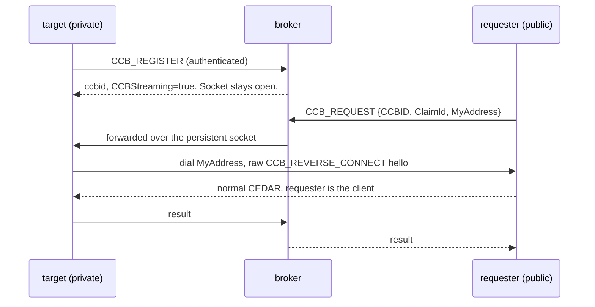
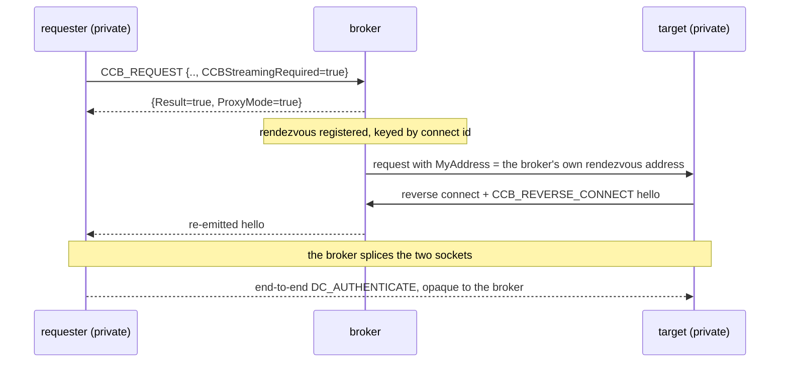

# Developing htc-ccb

For people changing the code. Administrators want the [README](../README.md)
and [ADMIN_TUNNELING.md](ADMIN_TUNNELING.md) instead.

---

## 1. The repository

One Go module, `github.com/bbockelm/golang-ccb`, rooted at the top. The broker
itself is the root package (`ccbserver`); the command is a thin wrapper that
reads HTCondor configuration and wires it up.

| Path | What is there |
|---|---|
| `server.go`, `request.go`, `reconnect.go` | the broker: registration, requests, reverse connects, the rendezvous table |
| `proxy.go`, `outbound.go`, `upstream.go` | the proxy/splice data path, outbound-proxy (exit) mode, registering upstream with a next hop |
| `carrier.go`, `carrier_check.go`, `wscarrier_auth.go` | carrier wiring, the `-carrier-check` diagnostic, bearer-token verification |
| `sqlitestore.go` | reconnect + session persistence (`modernc.org/sqlite`, cgo-free) |
| `cmd/htc-ccb/` | the daemon: flags, config, `condor_master` integration |
| `transport/carrier/` | yamux multiplexing over one byte pipe — what turns a single tunnel into many connections |
| `transport/wscarrier/` | the WebSocket carrier, including HTTP `CONNECT` through a site proxy |
| `transport/fstun/` | the filesystem carrier |
| `internal/proxytest/` | the in-process `CONNECT` proxy the fast tests use |
| `test/e2e-squid/` | the container tier: a real squid, a node with no route out |
| `packaging/` | nfpm configuration, the RPM build, the no-cgo check |

Dependencies of note: [`cedar`](https://github.com/bbockelm/cedar) for the
CEDAR wire protocol and security, and
[`golang-htcondor`](https://github.com/bbockelm/golang-htcondor) for
configuration, logging and the DaemonCore conventions.

---

## 2. Building

```sh
go build ./...
CGO_ENABLED=0 go build -trimpath -o htc-ccb ./cmd/htc-ccb
./packaging/check-static.sh htc-ccb
```

**Everything that ships is cgo-free and static.** `modernc.org/sqlite` is the
cgo-free SQLite driver for exactly this reason. The daemon runs on HPC worker
nodes whose glibc is older than any builder's, and the container image has no
libc at all, so a cgo build fails at exec time with an error that names neither
cause.

`CGO_ENABLED=0` in a workflow's `env:` is an intention, not a result — a step
that forgets it, a stale binary, or a dependency that grows a cgo-only path all
produce a cgo binary while the variable still reads 0. `check-static.sh` reads
the binary instead: the `CGO_ENABLED` build setting recorded by the toolchain
(`go version -m`), and, for an ELF, the absence of a program interpreter and of
`NEEDED` shared libraries. CI runs it on the binary it just built, the release
workflow on every artifact, and the Dockerfile on the binary it is about to put
on a `distroless/static` base.

---

## 3. Testing

```sh
go test ./... -count=1              # everything available on this machine
go test ./... -short                # skip the process-level pool tests
go test ./... -race -timeout=15m    # what CI runs
```

Four tiers, in ascending cost:

| Tier | Where | Needs | Runs |
|---|---|---|---|
| unit | `*_test.go` beside the code | nothing | every push |
| in-process end-to-end | `carrier_e2e_test.go`, `carrier_proxy_e2e_test.go`, `outbound_test.go` | nothing — the `CONNECT` proxy is `internal/proxytest` | every push |
| pool integration | `ccb_master_integration_test.go`, `binary_e2e_test.go` | `condor_master`, `condor_submit`, `condor_wait` on `PATH` | every push in CI, which installs HTCondor |
| container | `test/e2e-squid/` | Docker, a real squid | nightly, on push, or on a PR labelled `squid-e2e` |

The tiers that need something they cannot find **skip** rather than fail, which
is convenient locally and dangerous in CI: a run that skips the integration
tier is green and proves nothing about the pool. Check for `N passed`, not for
the absence of failures. CI installs HTCondor so the third tier really runs.

The container tier is its own thing; it is described in
[E2E_SQUID_WS.md](E2E_SQUID_WS.md) and driven by
`test/e2e-squid/README.md`:

```sh
cd test/e2e-squid
docker compose up --build --abort-on-container-exit --exit-code-from ep
docker compose down -v
```

Its first assertion is that the worker-node container has no route off its own
network. Everything after it would be vacuous otherwise.

Lint with the repository's own configuration:

```sh
golangci-lint run ./...
```

---

## 4. The protocol

Commands (from HTCondor's `condor_commands.h`): `CCB_REGISTER=67`,
`CCB_REQUEST=68`, `CCB_REVERSE_CONNECT=69`, `ALIVE=441`. All control messages
are a single CEDAR message carrying one ClassAd; the reverse-connect hello is a
raw command int plus a ClassAd, with no security handshake.

### 4.1 Standard flow — public requester, private target



1. **Register** — the target authenticates and is assigned a ccbid; the socket
   stays open. The reply advertises `CCBStreaming=true`.
2. **Request** — the client authenticates and sends
   `{CCBID, ClaimId=<connect-id>, MyAddress=<client listen addr>}`.
3. **Forward** — the broker relays the request down the target's socket.
4. **Reverse-connect** — the target dials `MyAddress` and sends the raw
   `CCB_REVERSE_CONNECT` hello; normal CEDAR follows, with the original
   requester as the client.
5. **Result** — the target reports success or failure to the broker, which
   relays it to the requester.

### 4.2 Streaming / proxy flow — both ends private

A private requester cannot accept a direct reverse connection, so it sends a
CCB-routed `MyAddress` (its own ccb sinful) together with
`CCBStreamingRequired=true`. The broker then:



1. registers a rendezvous keyed by the connect id and replies
   `{Result=true, ProxyMode=true}` to the requester;
2. forwards the request to the target with `MyAddress` set to the **broker's
   own** rendezvous address;
3. the target reverse-connects to the broker and sends its
   `CCB_REVERSE_CONNECT` hello;
4. the broker re-emits a hello to the requester and then **splices** the two
   sockets, acting as a transparent TCP proxy.

The end-to-end `DC_AUTHENTICATE` between the two real peers rides opaquely over
the splice, so CCB-session encryption is deliberately disabled on the proxy data
path. Security is preserved end to end, which is what makes it safe for a broker
to relay without holding anyone's keys.

### 4.3 Compatibility

A streaming-capable requester confirms broker support **before** sending a proxy
request: the broker's `$CondorVersion$` (exchanged in the security handshake)
must be at or above the streaming threshold, and/or the broker advertises
`CCBStreaming=true`. If streaming is required but unsupported, the requester
fails fast with `StreamingUnsupportedError` rather than sending a request an
older broker would mishandle. Standard CCB is unchanged in every direction.

The advertised version is derived from cedar's own `ccb.StreamingMinVersion`,
not written out. A literal version silently falls below the gate the moment
cedar raises it, and the symptom is remote — nested routing fails with "entry
broker does not support streaming" from a broker that does support it.

### 4.4 Carriers

Everything above assumes TCP. When the inside end has no outbound TCP at all,
the same protocol runs over a *carrier*: one byte pipe (a WebSocket through an
HTTP proxy, or a shared filesystem) with yamux multiplexing on top.
[TRANSPORTS.md](TRANSPORTS.md) is the design;
[ADMIN_TUNNELING.md](ADMIN_TUNNELING.md) is how it is deployed.

---

## 5. Packaging and releases

Tagging `vX.Y.Z` runs `.github/workflows/release.yml`, which builds the daemon
for linux and darwin on amd64 and arm64, checks every binary is static and
cgo-free, packages a tarball each and an RPM per Linux architecture, and
attaches them to a **draft** GitHub release with a `SHA256SUMS.txt`. Publishing
the draft is a separate, human act. A `workflow_dispatch` run does the same
build and uploads the result as a workflow artifact without touching releases,
which is how to exercise packaging without cutting a tag.

Build an RPM locally:

```sh
(cd .github/tools && GOWORK=off go build -o "$HOME/go/bin/nfpm" github.com/goreleaser/nfpm/v2/cmd/nfpm)
CGO_ENABLED=0 GOOS=linux GOARCH=amd64 go build -trimpath -o build/htc-ccb-amd64 ./cmd/htc-ccb
packaging/build-rpm.sh build/htc-ccb-amd64 amd64 v0.0.0-dev
```

- `packaging/nfpm.yaml` — what goes where. `nfpm` expands environment variables
  in scalar fields but globs `contents.src` literally, so the staging directory
  is written out rather than named by a variable; `build-rpm.sh` has to agree
  with it.
- `packaging/rpm-version.sh` — turns a tag or `git describe` into an RPM
  Version and Release. An untagged build gets a `0.`-prefixed release so it
  sorts *below* the release it is heading for, instead of shadowing it.
- `packaging/htc-ccb.conf` — installed as `%config(noreplace)`, everything
  commented out. A package that started a daemon on install would change the
  behaviour of the pool it was added to.
- `.github/tools/` — a module of its own whose only purpose is to pin `nfpm`
  so Dependabot bumps it and `go.sum` verifies it.

Third-party actions are pinned to a commit SHA with the version in a trailing
comment, which is the form Dependabot updates.
